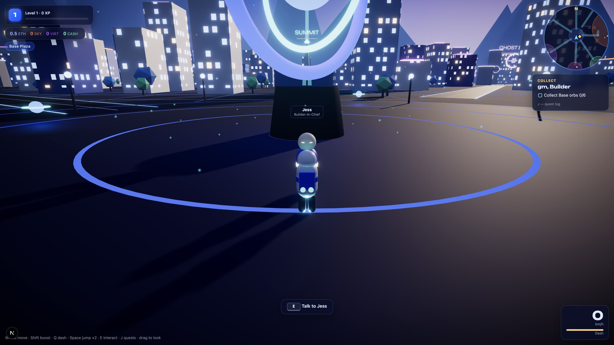
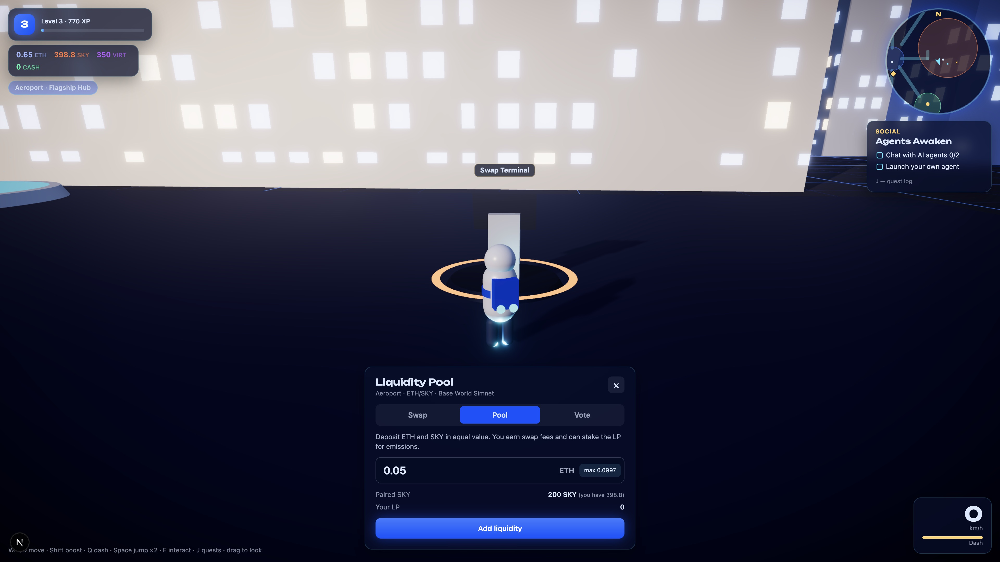
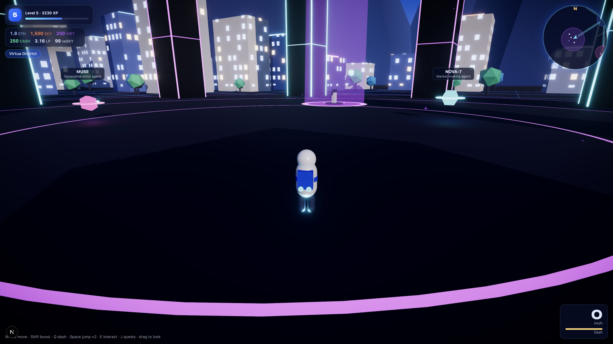

# base-world

A stylized 3D open world for the Base ecosystem, built with Next.js, React Three Fiber, Rapier and zustand. It has fast movement (boost, dash, hoverboard), quest givers and protocol districts. The landing page offers two modes:

- **Offline** (`/offline`): no account, progress in `localStorage`, every onchain action simulated by `mockChain`.
- **Online** (`/online`): sign in with Privy (social or wallet, embedded wallet created when needed, "Add funds" for embedded wallets), one shared world over Supabase Realtime, saves and a transaction log in Supabase. Swaps and liquidity (Aerodrome), lending (Morpho WETH/USDC market, Aave V3) and transfers are real Base mainnet transactions from the player's wallet, capped at $50 each; voting, launchpads, hooks and flash loans stay simulated with game credits.

```bash
corepack enable
pnpm install
pnpm dev        # http://localhost:3000
```

Online mode reads these from `.env.local`:

| Variable | Where |
|---|---|
| `NEXT_PUBLIC_PRIVY_APP_ID`, `PRIVY_APP_SECRET` | Privy dashboard → App settings |
| `NEXT_PUBLIC_SUPABASE_URL`, `NEXT_PUBLIC_SUPABASE_PUBLISHABLE_KEY` | Supabase → Project Settings → API Keys |
| `SUPABASE_SECRET_KEY` | Supabase → API Keys → Secret keys (server only) |
| `NEXT_PUBLIC_BASE_RPC_URL` | Optional dedicated Base RPC; defaults to `https://mainnet.base.org` |

`pnpm verify:contracts` re-checks every mainnet address in `components/world/contracts.ts` against live chain state.



## Controls

| Key | Action |
|---|---|
| WASD | Move |
| Shift | Boost on the hoverboard |
| Q | Dash |
| Space | Jump, press again in the air to double jump |
| E | Talk to NPCs, use terminals |
| J / Tab | Quest log |
| B | Base docs |
| Mouse drag, wheel, arrow keys | Orbit and zoom the camera |
| Esc | Close any window |

## Features

- 17 quests, from collecting orbs on Base Plaza to the "Stay Based" finale, with XP, levels, rewards and a waypoint to the next objective.
- A builder track: Devi and the Base Docs kiosk on the plaza (or press B anywhere) teach the short version of docs.base.org — Quickstart, DeFi, stablecoins, tokenized assets, payments, private transactions, AI agents and funding — with a quick check on every page and five Builder quests that pair reading with doing.
- Districts: the Summit (reached by jump pad), Aerodrome (swap, pool, gauge voting and the 26-second Runway Rush ring course), Virtuals (chat with AI agents and launch your own), Morpho (supply, borrow, repay with a health factor), Bankr (trade by chatting), Uniswap (swaps through hooks) and Aave (a one-block flash loan).
- HUD with a minimap, quest tracker, speedometer and dash charge, race timer, toasts and a quest log. Progress is saved in `localStorage`.




See [docs/HANDOFF.md](docs/HANDOFF.md) for how the code is organized and what could come next.

The font is Unbounded (SIL Open Font License, see `public/world/OFL.txt`).
